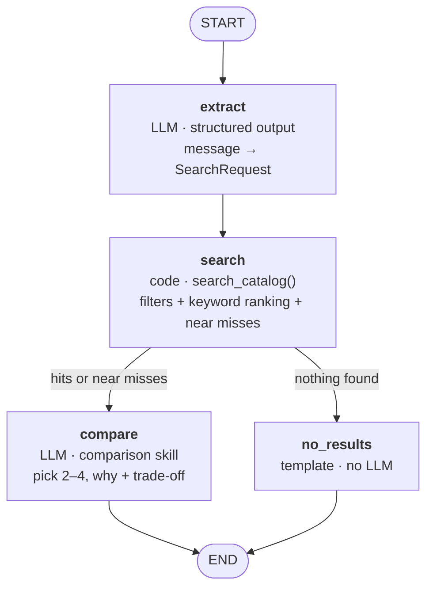

# Agent graph (`agent_graph.py`)

The agent graph answers one shopper message: it turns the message into search filters, searches the catalog, and
writes a short comparison of the best matches. It is a fixed LangGraph pipeline. Code decides the steps; the LLM
only works inside two of them.

- Code: [`agent_graph.py`](agent_graph.py)
- Search it calls: [`catalog_search.py`](catalog_search.py) (`search_catalog`)
- Write-up instructions for the LLM: [`skills/comparison_writeup.md`](skills/comparison_writeup.md)
- Retailer settings (LLM model, brand voice, catalog scope): [`config/retailers/`](config/retailers/)
- Tests: [`tests/test_agent_graph.py`](tests/test_agent_graph.py)

---

## Graph



Plain-text version:

```
START → extract → search ─┬─ (hits or near misses) → compare    → END
                          └─ (nothing found)       → no_results → END
```

There are no loops and no tool choice by the LLM. Every message takes the same path.

---

## State

The nodes share one dictionary, `AgentState`. Each node reads what it needs and adds its own output.

| Key | Set by | Contents |
|---|---|---|
| `retailer_id` | caller | `"nordstrom"` or `"calpak"` (from the session) |
| `user_prompt` | caller | The shopper's message |
| `request` | extract | `SearchRequest`: the filters and ranking words |
| `result` | search | `SearchResult`: exact hits, near misses, notes |
| `comparison` | compare / no_results | `Comparison`: summary plus picks |
| `answer` | compare / no_results | Final text shown to the shopper |
| `trace` | every node | One line per step, for debugging |

---

## Nodes

### 1. `extract` (LLM)

Turns the shopper's message into a `SearchRequest`.

1. Builds a system prompt (`extraction_prompt`) that lists the catalog's real product types, departments, sizes,
   size classes and colour words. These come from `catalog_facets`, cached per retailer, so the model can only
   choose values that exist.
2. Calls the retailer's LLM with structured output, so the reply is a validated `SearchRequest`, not free text.
3. Overwrites `retailer_id` with the session's value. The model never decides which retailer is searched.

Rules given to the model: fill only what the shopper said; never guess a budget, size or colour; put leftover
descriptive words (materials, styles, occasion) in `query`.

Example: `"Navy blazer under $150 in size M"` →
`{product_types: [blazer], colour: navy, size: M, max_price: 150}`

### 2. `search` (code, no LLM)

Calls `search_catalog(request)`:

1. **Filters**: type, department, brand, colour, size, price and stock decide which products are eligible.
2. **Ranking**: the `query` words rank the eligible products (Postgres full-text search). Products without a
   keyword match follow, ordered by rating.
3. **Near misses**: if there are fewer than 3 results, it searches again with price up to 10% over budget and
   other shades of the same colour, and labels each with why it missed. Size is never relaxed.

See [`../search.md`](../search.md) for how filtering and ranking work in detail.

### 3. Router

`route` sends the state to `compare` if there is at least one hit or near miss, otherwise to `no_results`.

### 4. `compare` (LLM)

Writes the answer.

1. Fills the comparison skill template with the retailer name, the shopper's message and compact product cards
   (`_compact`: IDs, title, brand, type, colours, sizes in stock, rating, promotion, miss reasons).
2. Adds the retailer's brand voice and calls the LLM with structured output (`Comparison`: a summary and 2–4
   picks, each with a reason and a trade-off).
3. **Grounding check:** drops any pick whose `product_id` is not in the search results, so the model cannot
   invent a product. It also sets `is_near_miss` from the search results, not from the model.
4. `render_answer` turns the picks into the final text.

### 5. `no_results` (template, no LLM)

Returns a fixed message suggesting the shopper relax the budget, colour or size, prefixed with any search notes
(for example "No brand like 'Zara' at this retailer."). It doesn't call the LLM.

---

## How it was built (high level)

1. **Typed contracts first.** `SearchRequest` (in `catalog_search.py`) and `Comparison` / `Pick` (here) are
   pydantic models. Both LLM calls use structured output against them, so every step passes validated data.
2. **Search stays deterministic.** The search node is plain code over Postgres; the LLM never writes SQL.
3. **The LLM sees only real catalog values**, from the cached facets, which keeps extracted filters valid.
4. **Prompts live in files and config.** The comparison instructions are in `skills/comparison_writeup.md`; the
   model, temperature and brand voice are in the retailer JSON. Changing them needs no code change.
5. **Guardrails in code.** The retailer comes from the session; picks are grounded against search results.
6. **Dependencies can be swapped.** `build_graph(chat_model=..., search=..., facets=...)` accepts fakes, which is
   how the offline tests run without OpenAI or a database.
7. **A trace on every step**, so a run can be debugged from the printed trace alone.

---

## Running it

### Setup

```bash
python -m venv .venv && source .venv/bin/activate
pip install -r backend/requirements.txt
```

- `OPENAI_API_KEY`: put it in `backend/.env` (git-ignored) or export it. Never put it in `backend/.env.local`,
  which is tracked.
- `DATABASE_URL`: read from the environment or `backend/.env.local`.

### Ask one question (needs OpenAI and the database)

Run from the repository root:

```bash
python -m backend.agent_graph "Navy blazer under \$150 in size M" --retailer nordstrom
python -m backend.agent_graph "I need a hard shell carry-on suitcase" --retailer calpak
```

It prints the trace, then the answer (the counts below are illustrative):

```
extract: {'retailer_id': 'nordstrom', 'product_types': ['blazer'], 'colour': 'navy', 'size': 'M', 'max_price': 150.0}
search: 7 exact, 0 near misses
compare: 3 picks

<summary and numbered picks>
```

From Python:

```python
from backend.agent_graph import run

state = run("Navy blazer under $150 in size M", retailer_id="nordstrom")
print(state["trace"])
print(state["answer"])
```

---

## Testing

### Offline tests (no OpenAI, no database)

```bash
python -m unittest backend.tests.test_agent_graph -v
```

These use a `FakeModel` that returns canned `SearchRequest` and `Comparison` objects and a fake `search`
function, injected through `build_graph(...)`. They run in under a second.

| Test | What it checks |
|---|---|
| `test_prompt_flows_through_extract_search_compare` | The full path: the extracted request reaches search, the results reach the comparison prompt, the extraction prompt lists the allowed types, and the user's message is passed unchanged |
| `test_retailer_comes_from_the_session_not_the_model` | If the model returns the wrong retailer, the session's retailer is still searched |
| `test_invented_product_ids_are_dropped` | A pick with an ID not in the results is removed; near-miss status comes from the search |
| `test_no_results_skips_the_write_up_model` | With zero results the graph goes to `no_results` and calls the LLM only once (for extraction) |

### Live tests (real OpenAI and database)

```bash
RUN_LLM_TESTS=1 python -m unittest backend.tests.test_agent_graph -v
```

This runs six real shopper prompts (Nordstrom and Calpak) end to end. For each one it checks that:

- the expected filters were extracted (type, colour, size, budget, brand, or a word in `query`);
- the search returned something;
- every pick is a product from the search results.

It prints each trace and answer, so it doubles as a quick manual review. It costs a few LLM calls per run.

### Adding a test case

- **New live prompt:** add a tuple to `PROMPTS` in `tests/test_agent_graph.py`:
  `("nordstrom", "Black leather boots size 8", {"product_types": "boots", "colour": "black", "size": "8"})`.
- **New offline behaviour:** build the graph with `self.build(extracted_request, comparison, search_result)` and
  assert on the returned state, `self.searched` (what search received) or `model.calls` (what the LLM saw).

---

## Known limits

- Vague or style requests ("something classy") rely on keyword matching only until semantic search is turned on.
- No clarifying-question route: the graph always searches.
- Outfits ("an outfit for a wedding") run as one search, not one per item.
- A brand the retailer doesn't carry returns no results.

Details and proposed fixes: [`../search.md`](../search.md), sections 12–13.
