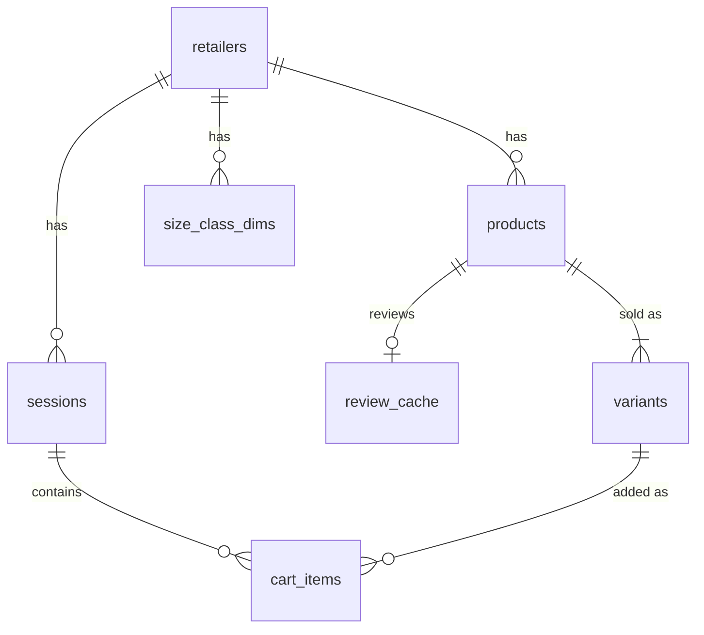

# Database Design: Retail Shopping Agent Platform (V1)

_Team 12 · Nov 16, 2026 · Postgres 16 + pgvector (≥ 0.8) + pg_trgm · sources: PRD v2, plan.md_

This document defines every table and column the V1 agent uses, explains what each column is for, and shows where the value comes from in the Nordstrom and Calpak CSVs.

---

## 1. Overview

### 1.1 Design rules

1. **One product = one search document.** Keyword and semantic search rank `products`.
2. **Everything you can buy, filter on, or that has stock lives on `variants`**: price, colour, size, stock. Exact filters run against variants.
3. **Every table carries `retailer_id`.** Retailer data never mixes (PRD platform lock: "data, config and logs stay isolated").
4. **Facts come from data, never the LLM.** Columns the LLM inferred (`occasion_tags`, `style_tags`) are used only for ranking, never for hard filters.
5. **Synthetic data is always flagged** (`synthetic_flags`, `review_cache.is_synthetic`, `size_class_dims.is_typical`) so the UI can label it.

### 1.2 Tables at a glance

| Table | One row is | Written by | Read by |
|---|---|---|---|
| `retailers` | A configured retailer | Config loader | Everything |
| `products` | A product (search document) | Pipeline | `search_catalog`, cards, comparison |
| `variants` | A buyable unit (colour × size) with price and stock | Pipeline | `search_catalog`, cart |
| `size_class_dims` | Typical dimensions of a luggage size class | Seed script | `airline_fit_check` |
| `airline_limits` | One airline's bag size limit | Seed script | `airline_fit_check` |
| `review_cache` | Synthetic reviews for one product | Pipeline + `get_reviews` | Cards, comparison write-up |
| `sessions` | A shopper conversation | API | Cart |
| `cart_items` | One item in a mock cart | `add_to_cart` | Cart UI |

### 1.3 Relationships



---

## 2. Extensions and helpers

```sql
CREATE EXTENSION IF NOT EXISTS vector;    -- pgvector: embedding column + HNSW index
CREATE EXTENSION IF NOT EXISTS pg_trgm;   -- trigram similarity: typo-tolerant title/brand matching

-- array_to_string() is STABLE, and generated columns need IMMUTABLE expressions.
-- This wrapper is safe for text[] and lets search_tsv be a generated column.
CREATE FUNCTION arr_text(a text[]) RETURNS text
  LANGUAGE sql IMMUTABLE PARALLEL SAFE
  AS $$ SELECT coalesce(array_to_string(a, ' '), '') $$;
```

---

## 3. `retailers`

```sql
CREATE TABLE retailers (
  retailer_id    text PRIMARY KEY CHECK (retailer_id ~ '^[a-z0-9_]+$'),
  display_name   text NOT NULL,
  config         jsonb NOT NULL,
  config_hash    text NOT NULL,
  help_page_url  text,
  loaded_at      timestamptz NOT NULL DEFAULT now()
);
```

| Column | Type | Meaning | Example |
|---|---|---|---|
| `retailer_id` | text, PK | Short stable key used on every other table and in every API request | `nordstrom`, `calpak` |
| `display_name` | text | Name shown in the retailer switcher | `Nordstrom` |
| `config` | jsonb | Snapshot of the retailer's YAML config (field map, category packs, boosts, near-miss tolerances, denied topics). The YAML file is the source of truth; this copy is for auditing and joins | `{"merchandising": {"boosts": [...]}}` |
| `config_hash` | text | Hash of the config file. Logged with every eval run so results can be tied to an exact config version | `sha256:9f2c…` |
| `help_page_url` | text | Where policy questions are redirected (M11) | `https://www.nordstrom.com/browse/customer-service` |
| `loaded_at` | timestamptz | When this config was last loaded | |

---

## 4. Colour attributes

Each variant stores its raw retailer colour value, normalized `colour_family`, and `colour_shade` directly. The
retailer-specific enrichment code/config maps Nordstrom codes and CALPAK colour names; it does not persist lookup
tables in the database. The platform's allowed families and same-family near-miss adjacency are enforced in code.

The family is used for the hard colour filter (`red` → `red_pink`); shade is used to distinguish exact matches from
labelled near misses (`red` exact, `burgundy` adjacent, `blue` never). A missing or uncertain shade remains nullable.

---

## 5. `products`

One row per product. This is the **search document**: keyword search and semantic search both rank these rows.

```sql
CREATE TABLE products (
  -- identity
  product_id         bigserial PRIMARY KEY,
  retailer_id        text NOT NULL REFERENCES retailers,
  external_id        text NOT NULL,
  -- descriptive facts
  title              text NOT NULL,
  brand              text,
  product_line       text,
  department         text NOT NULL,
  product_type       text NOT NULL,
  source_categories  text[] NOT NULL DEFAULT '{}',
  tags               text[] NOT NULL DEFAULT '{}',
  description        text,
  best_for           text,
  features           text[] NOT NULL DEFAULT '{}',
  attrs              jsonb  NOT NULL DEFAULT '{}',
  -- inferred (ranking only)
  occasion_tags      text[] NOT NULL DEFAULT '{}',
  style_tags         text[] NOT NULL DEFAULT '{}',
  -- luggage
  size_class         text CHECK (size_class IN ('mini_carry_on','carry_on','medium','large','set')),
  -- display facts
  rating             numeric(2,1) CHECK (rating BETWEEN 0 AND 5),
  review_count       int CHECK (review_count >= 0),
  promotion          text,
  image_url          text,
  product_url        text,
  -- search
  search_text        text NOT NULL,
  search_tsv         tsvector GENERATED ALWAYS AS (
                       setweight(to_tsvector('simple',  coalesce(brand,'') || ' ' || coalesce(product_line,'')), 'A') ||
                       setweight(to_tsvector('english', title), 'A') ||
                       setweight(to_tsvector('english', product_type || ' ' || arr_text(source_categories)), 'B') ||
                       setweight(to_tsvector('english', arr_text(tags) || ' ' || coalesce(best_for,'') || ' ' ||
                                                         arr_text(occasion_tags) || ' ' || arr_text(style_tags)), 'C') ||
                       setweight(to_tsvector('english', coalesce(description,'')), 'D')
                     ) STORED,
  embedding          vector(1024),
  embedding_model    text,
  embedded_at        timestamptz,
  -- housekeeping
  synthetic_flags    text[] NOT NULL DEFAULT '{}'
                     CHECK (synthetic_flags <@ ARRAY['sizes','stock','dimensions','occasion_tags','style_tags']),
  is_active          boolean NOT NULL DEFAULT true,
  source_payload     jsonb,
  created_at         timestamptz NOT NULL DEFAULT now(),
  updated_at         timestamptz NOT NULL DEFAULT now(),
  UNIQUE (retailer_id, external_id),
  UNIQUE (product_id, retailer_id)          -- lets variants enforce the same retailer
);
```

### 5.1 Identity

| Column | Type | Meaning | Nordstrom | Calpak |
|---|---|---|---|---|
| `product_id` | bigserial, PK | Internal ID. Used in tool results, cards, the cart and the grounding check | generated | generated |
| `retailer_id` | text, FK | Owning retailer. Every query filters on it first | `nordstrom` | `calpak` |
| `external_id` | text | The retailer's own ID, for tracing back to the CSV and building links | `SKU` (after dedupe) | `product_id` |

### 5.2 Descriptive facts

| Column | Type | Meaning | Nordstrom | Calpak |
|---|---|---|---|---|
| `title` | text | Product name as shown to the shopper | `PRODUCT_NAME` | `title` |
| `brand` | text | Brand, normalised (case, spelling). Used for boost rules and keyword search | `BRAND` | Always `CALPAK` (the `vendor` column is not a brand) |
| `product_line` | text | Collection within a brand | NULL | `vendor` (e.g. `Luka`, `Terra`, `Vault`) |
| `department` | text | Top-level grouping, used for out-of-catalog checks and category packs | from `CATEGORY` (`clothing`, `shoes`, `bags`, `accessories`) | from `product_type` (`luggage`, `bags`, `accessories`) |
| `product_type` | text | **Our normalized taxonomy label. The main category filter and the outfit slot key.** The pipeline derives it deterministically from the source category and title; it does not ask an LLM to label catalog rows | Resolved from source categories and title rules (`Suit Jacket → blazer`); ambiguous labels retain a normalized source category | Mapped from `product_type` (`Carry-On Luggage → carry_on_luggage`, `Tote → tote`) |
| `source_categories` | text[] | The retailer's original category labels, kept as they were. Adds search words and shows where the product came from. **Not used as a filter** | All `SUBCATEGORY` values the SKU appeared under, e.g. `{"Blazers, Suits & Separates","Coats & Jackets"}` | `{product_type}`, e.g. `{"Carry-On Luggage"}` |
| `tags` | text[] | Meaningful retailer tags after removing internal codes | empty | Cleaned `tags`: keep e.g. `Hard Shell`, `Expandable`, `New Arrivals`, `Final Sale`; strip `BFCM26`, `pc-23019`, `HOTDEAL1`, `dad25`, `allproducts`… |
| `description` | text | Full product description | NULL (dataset has none) | `description_text` |
| `best_for` | text | The "Best for:" sentence from the description. Feeds search and the comparison | NULL | Parsed: `"Carry-on travel, weekend getaways, business trips and organized packing."` |
| `features` | text[] | Feature headings parsed from the "Features:" section. The comparison can cite these as real specs. Not in `search_tsv` separately, because `description` already contains them | empty | `{"Durable Hard-Shell Exterior","Aluminum Frame Construction","Anywhere-Stop Trolley",…}` |
| `attrs` | jsonb | Structured attributes that don't deserve their own column. Category-specific, read by the category pack | `{}` | e.g. `{"laptop_in": 15}` extracted from "fits laptops up to 15\"" |

### 5.3 Inferred attributes (ranking only)

| Column | Type | Meaning | How it is filled |
|---|---|---|---|
| `occasion_tags` | text[] | Occasions the product suits (`wedding`, `cocktail`, `work`, `hiking`, `travel`) | Offline small-model pass over title + brand + type + categories (+ description for Calpak). **Built only if the L2 semantic eval shows search missing these.** Mark `occasion_tags` in `synthetic_flags` |
| `style_tags` | text[] | Style words (`classy`, `casual`, `tailored`, `cozy`) | Same pass |

These are LLM guesses. They **raise the ranking** of a match (through `search_tsv` weight C and through `search_text` → `embedding`) but are **never hard filters**: a dress not tagged `wedding` is still eligible for a wedding search.

### 5.4 Luggage

| Column | Type | Meaning | Nordstrom | Calpak |
|---|---|---|---|---|
| `size_class` | text | Luggage size class. Joins to `size_class_dims` for the carry-on fit check (M9) | NULL | From `product_type`: Mini Carry-On → `mini_carry_on`, Carry-On → `carry_on`, Medium → `medium`, Large → `large`, Luggage Sets → `set` |

### 5.5 Display facts

| Column | Type | Meaning | Nordstrom | Calpak |
|---|---|---|---|---|
| `rating` | numeric(2,1) | **Real** average star rating, one decimal. NULL = no rating (never 0, never imputed). Shown on the card; breaks ties in ranking | `REVIEW_RATING` (NULL for ~56% of rows) | NULL (no rating data) |
| `review_count` | int | **Real** number of reviews behind `rating` | `REVIEW_COUNT` | NULL |
| `promotion` | text | Sale label shown on the card | `PROMOTION` | Derived: "Sale" when `compare_at_price` > `price` |
| `image_url` | text | Default product image | NULL (no images; source still open) | `image_url` of the first variant |
| `product_url` | text | Link to the retailer's product page | NULL | `product_url` without the `?variant=` part |

Synthetic review **text** is not stored here. It lives in `review_cache` so real numbers and generated text never mix.

### 5.6 Search columns

| Column | Type | Meaning |
|---|---|---|
| `search_text` | text | One readable paragraph built from the useful fields. **This is the text sent to the embedding model**, and the first thing to read when a search result looks wrong |
| `search_tsv` | tsvector, generated | **Keyword index.** Postgres builds it automatically from the columns on every insert and update; it is never written directly. Words are lowercased, stemmed (`jackets → jacket`) and weighted by where they came from (table below) |
| `embedding` | vector(1024) | **Meaning index.** The embedding of `search_text`. Products with similar meaning have nearby vectors, even with no words in common. The dimension must match the chosen model (1024 for Voyage 3.x; change to 1536 for OpenAI `text-embedding-3-small`). NULL until the embed step runs |
| `embedding_model` | text | Model and version that made the vector. A query must be embedded with the **same** model, and evals log this |
| `embedded_at` | timestamptz | When the vector was made. If `search_text` changed after this, the product needs re-embedding |

**`search_tsv` weights**

| Weight | Built from | Text config | Why |
|---|---|---|---|
| A (1.0) | `brand`, `product_line` | `simple` (no stemming, no stop words) | Shoppers type brands exactly; keep them as written |
| A (1.0) | `title` | `english` | A word in the name is the strongest signal |
| B (0.4) | `product_type`, `source_categories` | `english` | Strong but broad |
| C (0.2) | `tags`, `best_for`, `occasion_tags`, `style_tags` | `english` | Helpful, partly inferred |
| D (0.1) | `description` | `english` | Long and noisy |

The numbers in brackets are `ts_rank_cd`'s default weights for A to D.

**`search_text` template**

```text
{title}. Brand: {brand}. Line: {product_line}. Type: {product_type}.
Categories: {source_categories}. Colours: {distinct variant shades/families}.
Tags: {tags}. Occasion: {occasion_tags}. Style: {style_tags}.
Best for: {best_for}. {first ~500 characters of description}
```

Empty parts are left out. The colours come from the product's variants, so "red carry-on" can match on meaning too.

### 5.7 Housekeeping

| Column | Type | Meaning |
|---|---|---|
| `synthetic_flags` | text[] | Which parts of this product are synthetic, so the UI can label them: `sizes`, `stock`, `dimensions`, `occasion_tags`, `style_tags`. Nordstrom products get `{sizes,stock}`; Calpak luggage gets `{dimensions}` |
| `is_active` | boolean | Soft delete. Search only uses active rows |
| `source_payload` | jsonb | The original CSV row(s), for debugging and re-running enrichment without reloading. For a deduped Nordstrom SKU, all its source rows |
| `created_at`, `updated_at` | timestamptz | Load audit |

### 5.8 Example rows

**Nordstrom, SKU 4578258** (tag values are illustrative)

```text
retailer_id        nordstrom
external_id        4578258
title              Etiennette B Good Wool Suit Jacket
brand              Theory
department         clothing
product_type       blazer
source_categories  {"Blazers, Suits & Separates","Coats & Jackets"}
occasion_tags      {work,interview}
style_tags         {tailored,polished,classic}
rating             4.1
review_count       85
synthetic_flags    {sizes,stock,occasion_tags,style_tags}
search_text        Etiennette B Good Wool Suit Jacket. Brand: Theory. Type: blazer. Categories: Blazers, Suits &
                   Separates; Coats & Jackets. Colours: blue. Occasion: work, interview. Style: tailored, polished, classic.
search_tsv         'theori':1A 'etiennett':2A 'b':3A 'good':4A 'wool':5A 'suit':6A 'jacket':7A 'blazer':8B ... 'work':...C
```

**Calpak, Vault Carry-On Luggage**

```text
retailer_id        calpak
title              Vault Carry-On Luggage
brand              CALPAK
product_line       Vault
department         luggage
product_type       carry_on_luggage
source_categories  {"Carry-On Luggage"}
tags               {"Hard Shell","Expandable"}
best_for           Carry-on travel, weekend getaways, business trips and organized packing.
features           {"Durable Hard-Shell Exterior","Aluminum Frame Construction","Cushioned Handle Grip",...}
size_class         carry_on
rating             NULL
synthetic_flags    {dimensions}
```

---

## 6. `variants`

One row per buyable unit. **All hard filters (price, colour, size, stock) run here.**

```sql
CREATE TABLE variants (
  variant_id           bigserial PRIMARY KEY,
  product_id           bigint NOT NULL,
  retailer_id          text   NOT NULL,
  external_variant_id  text,
  sku                  text,
  colour_raw           text,
  colour_family        text CHECK (colour_family IS NULL OR colour_family IN
                         ('black_grey','white','brown','green','blue',
                          'purple','red_pink','yellow_gold','orange','multi')),
  colour_shade         text,
  size_label           text,
  size_norm            text NOT NULL DEFAULT 'ONE_SIZE',
  price                numeric(10,2) NOT NULL CHECK (price > 0),
  was_price            numeric(10,2),
  in_stock             boolean NOT NULL,
  image_url            text,
  variant_url          text,
  FOREIGN KEY (product_id, retailer_id) REFERENCES products (product_id, retailer_id) ON DELETE CASCADE,
  CHECK (was_price IS NULL OR was_price > price),
  UNIQUE (variant_id, retailer_id)
);

-- COALESCE makes variants with an unknown colour participate in the unique key.
CREATE UNIQUE INDEX variants_product_colour_size_uq
  ON variants (product_id, (coalesce(colour_raw, '')), size_norm);
```

| Column | Type | Meaning | Nordstrom | Calpak |
|---|---|---|---|---|
| `variant_id` | bigserial, PK | Internal ID. **This is what goes into the cart** (a product in a specific colour and size) | generated | generated |
| `product_id` | bigint | Parent product | parent SKU row | parent product |
| `retailer_id` | text | Copied from the product. The composite FK guarantees it matches, so retailer data can't mix | `nordstrom` | `calpak` |
| `external_variant_id` | text | Retailer's variant ID | NULL | `variant_id` |
| `sku` | text | Retailer's variant SKU | `SKU` | `sku` (e.g. `BCST2601-DARK-CHERRY`) |
| `colour_raw` | text | Colour exactly as in the CSV | `COLOR` as text (`498`, `020`) | `option1_value` (`DARK CHERRY`) |
| `colour_family` | text | **Hard-filter colour.** Normalized by retailer-specific enrichment code | from code prefix | from named-color mapping |
| `colour_shade` | text | **Exact vs. near-miss colour.** NULL when only the family is known | hand-checked codes only | normalized by color mapping |
| `size_label` | text | Size as shown to the shopper | Synthetic: `XS`–`XL` for clothing, `5`–`11` for shoes | NULL (Calpak variants are colours only) |
| `size_norm` | text | Normalised size used in filters. `ONE_SIZE` for unsized items (bags, jewelry, luggage) | `S`, `M`, `8`, `8.5` or `ONE_SIZE` | `ONE_SIZE` |
| `price` | numeric(10,2) | **Current online price, used for the budget check** (PRD matching rule 5). No shipping or tax | `PRICE_CURRENT` (same for all sizes) | `price` |
| `was_price` | numeric(10,2) | Previous price shown as "was"; only set when higher than `price` | `PRICE_RETAIL` if > current | `compare_at_price` if > price |
| `in_stock` | boolean | Whether this variant can be bought | **Synthetic**, fixed random seed, per size | `available` (real; 560 of 1,733 false) |
| `image_url` | text | Variant-specific image (the right colour) | NULL | `image_url` |
| `variant_url` | text | Deep link to this variant | NULL | `product_url` |

**How the rows are shaped**

- **Nordstrom:** each SKU is already one colour. The pipeline creates one variant per synthetic size: a dress SKU gets 5 rows (XS–XL), a bag gets one `ONE_SIZE` row. Price and colour are copied to every size.
- **Calpak:** one variant per colour row in the CSV, all `ONE_SIZE`. Excluded at load: zero-price rows, `Patch`/`Shipping Options`/`Amount` option rows, gift cards, personalisation and merchandise.

---

## 7. Luggage and airline tables

```sql
CREATE TABLE size_class_dims (
  retailer_id  text NOT NULL REFERENCES retailers,
  size_class   text NOT NULL,
  h_in         numeric(4,1) NOT NULL,
  w_in         numeric(4,1) NOT NULL,
  d_in         numeric(4,1) NOT NULL,
  is_typical   boolean NOT NULL DEFAULT true,
  source       text NOT NULL,
  PRIMARY KEY (retailer_id, size_class)
);

CREATE TABLE airline_limits (
  airline      text,
  bag_type     text CHECK (bag_type IN ('carry_on','personal_item')),
  max_h_in     numeric(4,1) NOT NULL,
  max_w_in     numeric(4,1) NOT NULL,
  max_d_in     numeric(4,1) NOT NULL,
  max_lb       numeric(4,1),
  source_url   text NOT NULL,
  checked_on   date NOT NULL,
  PRIMARY KEY (airline, bag_type)
);
```

**`size_class_dims`**: Calpak has no dimensions, so each size class gets typical dimensions (PRD Calpak change 5). Values and source are still an open question.

| Column | Meaning |
|---|---|
| `retailer_id`, `size_class` | Which retailer's which class (`calpak`, `carry_on`) |
| `h_in`, `w_in`, `d_in` | Height, width and depth in inches. Code sorts both these and the airline limits before comparing, so orientation doesn't matter |
| `is_typical` | `true` makes the reply say "typical size for this class" and never guarantee a fit (M9) |
| `source` | Where the numbers came from |

**`airline_limits`**: the airline lookup table (PRD Calpak change 6). Which airlines go in is still open.

| Column | Meaning |
|---|---|
| `airline` | Airline name |
| `bag_type` | `carry_on` (overhead bin) or `personal_item` (under the seat) |
| `max_h_in`, `max_w_in`, `max_d_in` | Size limit in inches |
| `max_lb` | Weight limit if the airline has one (informational; Calpak weight data isn't reliable) |
| `source_url`, `checked_on` | Proof and freshness; shown if the shopper asks |

---

## 8. `review_cache`

```sql
CREATE TABLE review_cache (
  product_id      bigint PRIMARY KEY,
  retailer_id     text NOT NULL,
  reviews         jsonb NOT NULL,
  highlights      jsonb,
  rating_basis    numeric(2,1),
  is_synthetic    boolean NOT NULL DEFAULT true,
  pregenerated    boolean NOT NULL DEFAULT false,
  model           text NOT NULL,
  prompt_version  text NOT NULL,
  generated_at    timestamptz NOT NULL DEFAULT now(),
  FOREIGN KEY (product_id, retailer_id)
    REFERENCES products (product_id, retailer_id) ON DELETE CASCADE
);
```

| Column | Meaning |
|---|---|
| `product_id` | Product these reviews belong to (one cache row per product) |
| `retailer_id` | Owning retailer (isolation) |
| `reviews` | 3 to 8 generated reviews: `[{"stars": 4, "title": "...", "text": "..."}]` |
| `highlights` | Short pros and cons pulled from the reviews, used by the comparison write-up: `{"pros": [...], "cons": [...]}` |
| `rating_basis` | The real rating the reviews were generated to match. Lets an eval check consistency, e.g. a 4.1 product shouldn't get mostly 2-star reviews. NULL for Calpak |
| `is_synthetic` | Always `true` in V1; drives the "synthetic reviews" label |
| `pregenerated` | `true` for demo-scenario products made offline; `false` for ones made on first view |
| `model`, `prompt_version`, `generated_at` | Which model and prompt made them, for regenerating and evals |

---

## 9. Sessions and cart

The conversation itself (messages, limits, candidates) is stored by the **LangGraph Postgres checkpointer** in its own tables. These two tables only hold what the API and UI need.

```sql
CREATE TABLE sessions (
  session_id   text PRIMARY KEY,
  retailer_id  text NOT NULL REFERENCES retailers,
  created_at   timestamptz NOT NULL DEFAULT now(),
  UNIQUE (session_id, retailer_id)
);

CREATE TABLE cart_items (
  cart_item_id  bigserial PRIMARY KEY,
  session_id    text NOT NULL,
  retailer_id   text NOT NULL,
  variant_id    bigint NOT NULL,
  qty           int NOT NULL DEFAULT 1 CHECK (qty > 0),
  outfit_id     text,
  price_at_add  numeric(10,2) NOT NULL,
  added_at      timestamptz NOT NULL DEFAULT now(),
  FOREIGN KEY (session_id, retailer_id) REFERENCES sessions (session_id, retailer_id) ON DELETE CASCADE,
  FOREIGN KEY (variant_id, retailer_id) REFERENCES variants (variant_id, retailer_id),
  UNIQUE (session_id, variant_id)
);
```

| Column | Meaning |
|---|---|
| `sessions.session_id` | ID the UI sends with every request; also the LangGraph thread ID |
| `sessions.retailer_id` | The retailer this conversation belongs to. Switching retailer starts a new session |
| `cart_items.variant_id` | The exact colour and size added |
| `cart_items.qty` | Quantity |
| `cart_items.outfit_id` | Groups items added together as one outfit (L3), so the cart can show the outfit total |
| `cart_items.price_at_add` | Price when added, so the cart total doesn't change if data is reloaded |
| `cart_items.added_at` | Feeds the "time to decision" metric |

`add_to_cart` should also check that the variant's `retailer_id` matches the session's.

---

## 10. Indexes

```sql
-- Exact filters (variants)
CREATE INDEX variants_filter_idx  ON variants (retailer_id, product_id)
       INCLUDE (price, colour_family, colour_shade, size_norm, in_stock);
CREATE INDEX variants_colour_idx  ON variants (retailer_id, colour_family, price) WHERE in_stock;

-- Exact filters (products)
CREATE INDEX products_type_idx    ON products (retailer_id, product_type) WHERE is_active;
CREATE INDEX products_size_idx    ON products (retailer_id, size_class)   WHERE size_class IS NOT NULL;

-- Arrays
CREATE INDEX products_tags_idx     ON products USING gin (tags);
CREATE INDEX products_occasion_idx ON products USING gin (occasion_tags);

-- Keyword search
CREATE INDEX products_tsv_idx     ON products USING gin (search_tsv);
CREATE INDEX products_title_trgm  ON products USING gin (title gin_trgm_ops);
CREATE INDEX products_brand_trgm  ON products USING gin (brand gin_trgm_ops);

-- Semantic search
CREATE INDEX products_embedding_idx ON products USING hnsw (embedding vector_cosine_ops);
```

| Index | Serves |
|---|---|
| `variants_filter_idx` | The `EXISTS` check in every search: price, colour, size and stock without visiting the table |
| `variants_colour_idx` | Colour-led queries ("red dresses under $100") |
| `products_type_idx` | Category filter, outfit slot searches |
| `products_size_idx` | Carry-on lookups |
| GIN on `tags`, `occasion_tags` | `@>` (contains) and `&&` (overlaps) on arrays |
| GIN on `search_tsv` | Keyword search: maps each stemmed word to the rows that contain it |
| trigram on `title`, `brand` | Typos ("nordstorm", "calpack") via `%` and `similarity()` |
| HNSW on `embedding` | Fast nearest-neighbour search when the candidate set is large |

**HNSW and filters.** HNSW applies `WHERE` filters after walking its graph, so a selective filter can return fewer than k rows. Search therefore filters to the eligible set first and then sorts by distance (an exact scan, which takes milliseconds for a few thousand rows). If the HNSW index is used on large sets, set `SET hnsw.iterative_scan = relaxed_order;` (pgvector ≥ 0.8).

---

## 11. Example queries

### 11.1 Exact: "Navy blazer under $150, size M"

```sql
SELECT p.product_id, p.title, min(v.price) AS price
FROM products p
JOIN variants v ON v.product_id = p.product_id
WHERE p.retailer_id = 'nordstrom' AND p.is_active
  AND p.product_type = 'blazer'
  AND v.in_stock AND v.price <= 150 AND v.size_norm = 'M'
  AND v.colour_family = 'blue'
GROUP BY p.product_id, p.title;
```

### 11.2 Keyword: "satin midi"

```sql
SELECT product_id, title, ts_rank_cd(search_tsv, q) AS score
FROM products, to_tsquery('english', 'satin & midi') q
WHERE retailer_id = 'nordstrom' AND search_tsv @@ q
ORDER BY score DESC LIMIT 50;
```

### 11.3 Semantic: "something classy for an evening party"

```sql
SELECT product_id, title, embedding <=> $qvec AS distance
FROM products
WHERE retailer_id = 'nordstrom' AND product_type = 'dress' AND is_active
ORDER BY distance LIMIT 50;
```

### 11.4 Hybrid (what `search_catalog` runs)

```sql
WITH eligible AS (
  SELECT p.product_id
  FROM products p
  WHERE p.retailer_id = $retailer AND p.is_active
    AND p.product_type = ANY ($types)
    AND EXISTS (SELECT 1 FROM variants v
                WHERE v.product_id = p.product_id AND v.in_stock
                  AND v.price <= $budget
                  AND ($size   IS NULL OR v.size_norm IN ($size, 'ONE_SIZE'))
                  AND ($family IS NULL OR v.colour_family = $family))
),
lex AS (
  SELECT p.product_id, row_number() OVER (ORDER BY ts_rank_cd(p.search_tsv, q) DESC) AS r
  FROM products p JOIN eligible USING (product_id), to_tsquery('english', $or_query) q
  WHERE p.search_tsv @@ q
  ORDER BY r LIMIT 50
),
sem AS (
  SELECT p.product_id, row_number() OVER (ORDER BY p.embedding <=> $qvec) AS r
  FROM products p JOIN eligible USING (product_id)
  ORDER BY r LIMIT 50
)
SELECT product_id,
       coalesce(1.0 / (60 + lex.r), 0) + coalesce(1.0 / (60 + sem.r), 0) AS rrf,
       lex.r AS lex_rank, sem.r AS sem_rank
FROM lex FULL OUTER JOIN sem USING (product_id)
ORDER BY rrf DESC LIMIT 20;
```

### 11.5 Near misses: "Red dress under $100, size M" (fewer than 3 exact)

```sql
SELECT p.product_id, v.variant_id, v.price, v.colour_shade,
       array_remove(ARRAY[
         CASE WHEN v.price > 100 THEN format('$%s over your budget', ceil(v.price - 100)) END,
         CASE WHEN v.colour_shade IS DISTINCT FROM 'red'
              THEN format('%s, not red', coalesce(v.colour_shade, 'shade not confirmed')) END
       ], NULL) AS miss_reasons
FROM products p JOIN variants v ON v.product_id = p.product_id
WHERE p.retailer_id = 'nordstrom' AND p.product_type = 'dress'
  AND v.in_stock AND v.size_norm = 'M'                       -- size is never relaxed
  AND v.price <= 110                                          -- +10% tolerance
  AND v.colour_family = 'red_pink'
  AND (v.colour_shade = 'red' OR v.colour_shade IS NULL
       OR v.colour_shade = ANY ($adjacent_shades))
  AND p.product_id <> ALL ($exact_ids);
```

`boost_and_rank` (Python) never boosts a row whose `miss_reasons` isn't empty (PRD matching rule 4).
`$adjacent_shades` is supplied by the code-enforced matching rules and contains only same-family shades.

### 11.6 Carry-on fit (Calpak)

```sql
SELECT p.title, d.h_in, d.w_in, d.d_in, d.is_typical,
       count(*) FILTER (WHERE a.fits) AS airlines_ok,
       count(*)                       AS airlines_total
FROM products p
JOIN size_class_dims d ON d.retailer_id = p.retailer_id AND d.size_class = p.size_class
CROSS JOIN LATERAL (
  SELECT (d.h_in <= al.max_h_in AND d.w_in <= al.max_w_in AND d.d_in <= al.max_d_in) AS fits
  FROM airline_limits al WHERE al.bag_type = 'carry_on'
) a
WHERE p.retailer_id = 'calpak' AND p.size_class IN ('mini_carry_on', 'carry_on')
GROUP BY p.product_id, p.title, d.h_in, d.w_in, d.d_in, d.is_typical;
```

(Load dimensions and limits already sorted largest to smallest so the comparison ignores orientation.)

---

## 12. Open decisions

| # | Decision | Affects |
|---|---|---|
| 1 | Nordstrom variant with known family but unknown shade: exact match, or near miss labelled "shade not confirmed"? (11.5 treats it as a near miss) | `colour_shade`, matching rules |
| 2 | Embedding model, which fixes the `vector(N)` dimension | `products.embedding` |
| 3 | Whether `occasion_tags` / `style_tags` are needed (decide after the first L2 retrieval eval) | Pipeline cost |
| 4 | Which Calpak product types are in demo scope beyond luggage | Category packs, `product_type` mapping |
| 5 | Luggage dimensions per size class and airline list, with sources | `size_class_dims`, `airline_limits` |
| 6 | Nordstrom image source | `image_url` |
