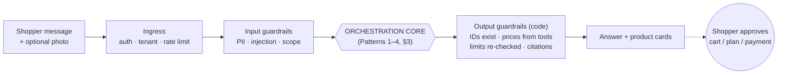
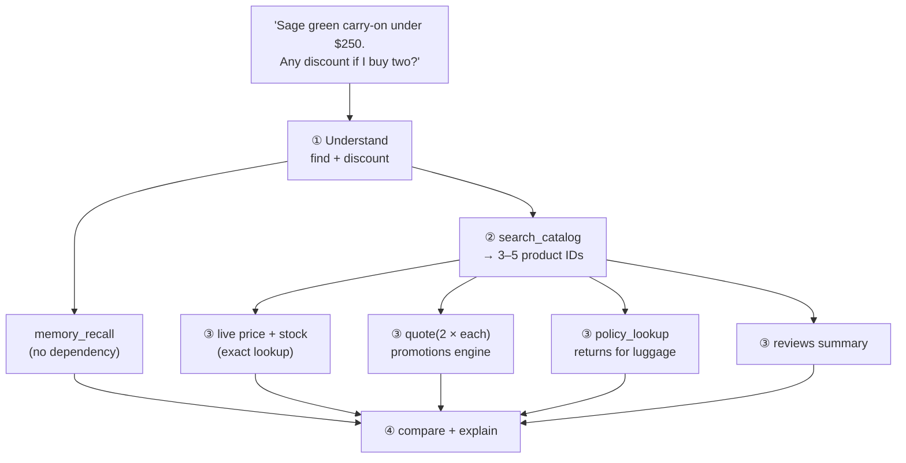
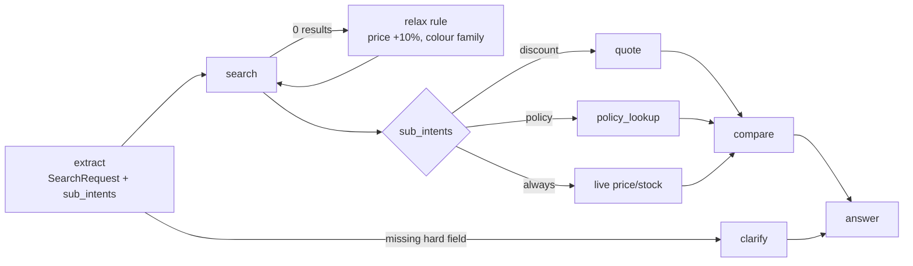
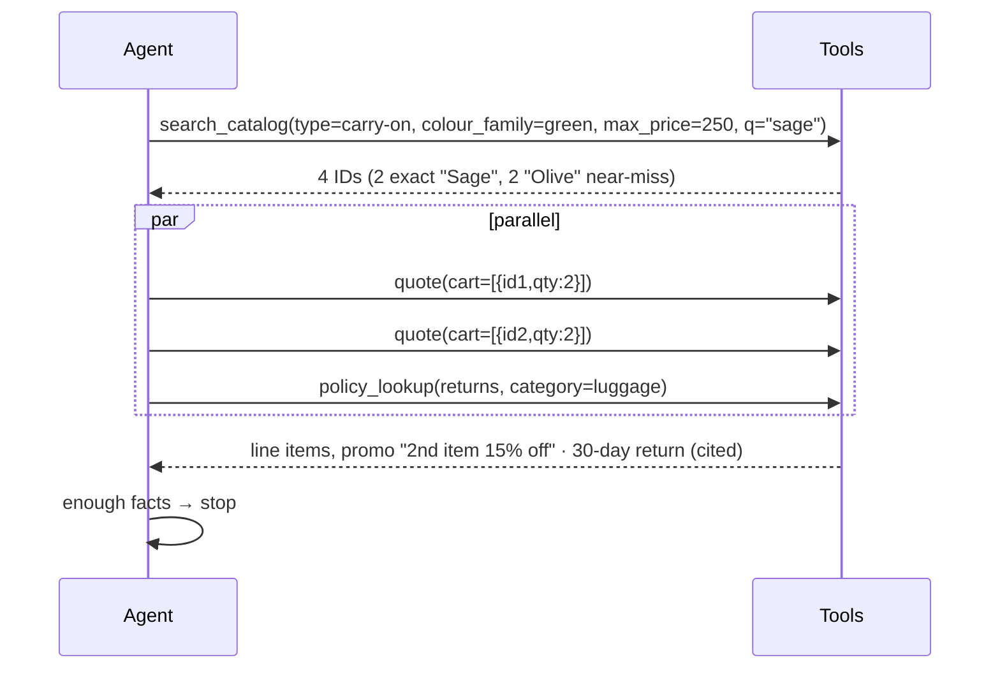
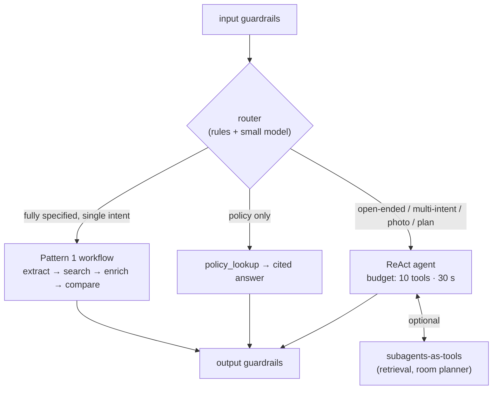
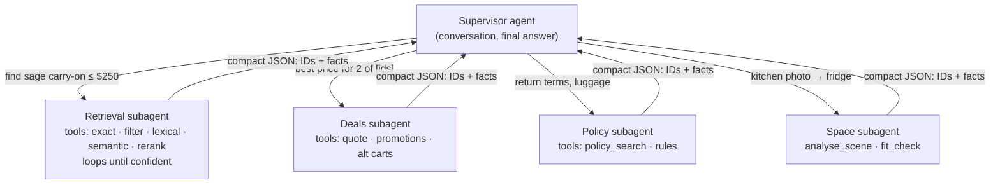
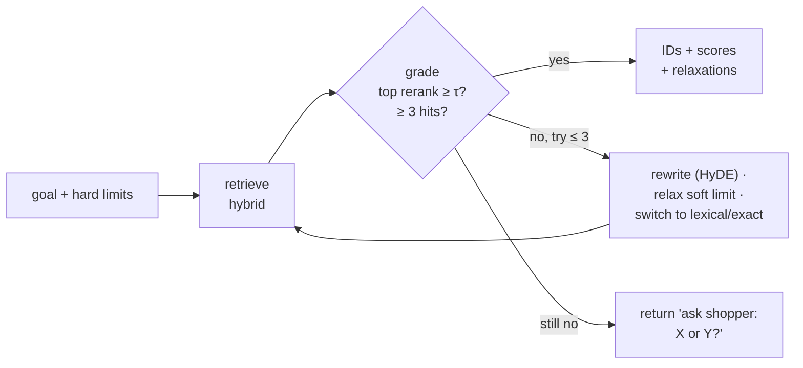
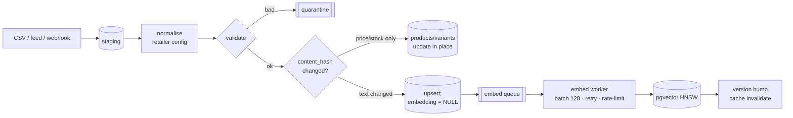

# V2 Request Flow, Orchestration and Agentic RAG: Options and Trade-offs

_Team 12 · draft Nov 17, 2026 · companion to `design-v2.md` (which lists the requirements). This document shows
**how a request moves through the system** and compares the options for orchestration, retrieval and ingestion._

> **Design only.** Like `design-v2.md`, nothing here drives code or schema changes. Model tiers, the embedding
> model and the tracing tool stay **(open)**. Semantic search is still on hold until Neon storage is confirmed.

**Short answer.** Use **Pattern 4 (hybrid)**: a router sends simple requests down a fixed workflow and open-ended
ones to a single tool-calling agent. Retrieval is **one hybrid search tool plus a few primitive tools**, and the
agent can call them in parallel. Fusion and reranking stay in code. Ingestion is **incremental, with hash diffs**,
and becomes event-driven for price and stock later. Subagents are reserved for two cases: a retrieval subagent
when search results flood the main context, and per-room planners for projects.

---

## 1. The request lifecycle (the same for every pattern)

Every pattern shares the same outer shell. Only the box in the middle changes.



Inside the core, nearly every shopping request runs through the same **four stages**. The order matters because
later stages need IDs from earlier ones:

| Stage | Question it answers | Needs | Produces |
|---|---|---|---|
| **① Understand** | What do they want, and what else did they ask? | Message, session, memory | `SearchRequest` + **sub-intents** (`find`, `discount`, `policy`, `fit`, `compare`, `reviews`) |
| **② Resolve products (the anchor)** | Which products match? | `SearchRequest` | Candidate `product_id`s with scores |
| **③ Enrich (fan-out)** | Price, deals, return terms, fit, reviews **for these IDs** | Candidate IDs | Facts per candidate (all from code or retrieval) |
| **④ Compose and verify** | What do we show and why? | Facts | Answer text + IDs; guardrails re-check |

### 1.1 The dependency graph (the "product first, then discount" flow)



Three rules come from this graph:

1. **Things that don't depend on product IDs run alongside retrieval.** Memory recall, a general policy question
   ("what's your return window?") and the active-promotions list can start at stage ①.
2. **Enrichers run in parallel once IDs exist**, and only the ones the sub-intents ask for. A plain "find me X"
   skips `quote` and `policy_lookup`.
3. **The anchor is not always the product.** Sometimes it is the deal or the policy:

| Request | Anchor | Flow |
|---|---|---|
| "Sage carry-on, any discount for two?" | Product | search → quote(cart of 2) |
| "What's on sale in luggage?" | **Promotion** | promotions → turn them into a **search filter** (`on_sale = true`, `was_price > price`) → search |
| "Can I return a used suitcase?" | **Policy** | policy_lookup only (no products) |
| "Is the Ambeur carry-on allowed on Spirit?" | **Exact product + rule** | exact_lookup → `airline_limits` check (code) |
| "Cheapest way to get the 3-piece set?" | **Cart** | search set and singles → quote both carts → compare totals |

A good orchestration lets the anchor change instead of hard-coding product → discount.

### 1.2 Where discounts actually come from (data reality)

- Today the only price signal is `was_price` / `compare_at_price` on the row. So "discount" means the **markdown
  already on the product**, computed in code.
- "Buy two, get X" needs a `promotions` table (rules, stacking, exclusions) and a `quote(cart)` tool in code
  (`design-v2.md` B4). **The LLM never does discount maths.** It decides *when* to call `quote` and explains the
  line items.
- For the demo, a hand-written promotions JSON per retailer config is enough to show the flow.

---

## 2. Running example

All four patterns are shown on the same request:

> **CALPAK shopper:** "I need a sage green carry-on under $250. Is there any discount if I buy two?"

Ideal output: 2–4 carry-ons in a sage/green colour family, each priced from data, a `quote` for two of each
(markdown + any multi-buy promo), the return window for luggage cited, and nothing padded.

---

## 3. Orchestration patterns

### Pattern 1 · Fixed workflow with conditional branches (V1, extended)

Code owns the graph. An extraction step emits sub-intents, and **conditional edges** fan out to enricher nodes.
LangGraph's `Send` API runs them in parallel.



**Example run:** extract → `{colour: sage, type: carry-on, max_price: 250, sub_intents: [find, discount]}` →
search → fan-out to `quote` + live price → compare. **2 LLM calls, ~3 s.**

| Strengths | Weaknesses |
|---|---|
| Predictable, cheap, fast; each node can be tested on its own | Every new flow (promo-anchored, cart comparison, photo) needs new edges |
| Easy to eval: the trajectory is fixed | Can't recover cleverly. "Sage" with zero hits only gets the fixed relax rule |
| Already built (`backend/agent_graph.py`) | Multi-intent requests turn into graph spaghetti |

### Pattern 2 · Single ReAct agent (tool-calling loop)

One mid-tier model, a system prompt, skills, and all tools. It thinks → calls tools (several in parallel) →
observes → repeats until done or out of budget.



**Example run:** 3 model turns, 4 tool calls, ~6–8 s. The agent works out on its own that "buy two" means calling
`quote` with qty 2.

| Strengths | Weaknesses |
|---|---|
| Handles any anchor and new combinations without new code | Cost and latency vary; context grows with each step |
| Natural recovery: rewrites the query, relaxes the least important limit, asks | Harder to eval (trajectory judging) and harder to debug |
| Parallel tool calls give fan-out for free | Can skip a tool it needed (e.g. states a discount without calling `quote`). Output guardrails must catch it |
| Simple mental model; one trace | Wasteful on simple requests, so it needs a router in front |

### Pattern 3 · Plan-and-execute (planner emits a DAG, code runs it)

A planner model turns the request into a **typed plan**, a small DAG where steps refer to earlier outputs. Code
executes it with maximum parallelism. If a step fails (zero results, low confidence), a **replanner** is called
once.

```json
{
  "steps": [
    {"id": "s1", "tool": "search_catalog", "args": {"product_type": "carry-on", "colour_family": "green", "max_price": 250, "query": "sage"}},
    {"id": "s2", "tool": "quote", "for_each": "$s1.ids", "args": {"qty": 2}},
    {"id": "s3", "tool": "policy_lookup", "args": {"type": "returns", "category": "luggage"}},
    {"id": "s4", "tool": "compose", "inputs": ["$s1", "$s2", "$s3"]}
  ]
}
```

**Example run:** 1 planner call + 1 compose call. Tools run in code (s1 and s3 together, then s2 per ID).
**2 LLM calls, ~4 s.**

| Strengths | Weaknesses |
|---|---|
| Makes the dependency graph (§1.1) **explicit**, and the anchor can change per request | The plan is fixed before any results come back, so it adapts less than ReAct between steps |
| Few LLM calls; plans can be validated in code before running (allowed tools, budget) | Needs a plan schema, a validator and an executor (more to build) |
| Plans are easy to eval: compare to a gold plan | Replanning adds a call and some complexity |
| Good fit for projects ("furnish 3 floors" → DAG of slot searches) | Planner mistakes spread to every step (one bad plan → bad answer) |

### Pattern 4 · Hybrid: router + workflow skeleton + agentic core (recommended)

The outer shell is a fixed graph. Inside it, **one node is a ReAct agent** for open-ended work. Simple requests
never reach the agent. This is `design-v2.md` A2.2 made concrete.



**Example run:** "under $250" and "carry-on" are fully specified, but "any discount if I buy two" adds a second
intent. If the router counts `discount` as a workflow branch (Pattern 1 fan-out), the request stays on the
workflow at **2 calls**. If the request were "something cute for a girls' trip, deals welcome", it would go to the
agent.

| Strengths | Weaknesses |
|---|---|
| Cheap and predictable for most traffic; agentic where it pays off | Two paths to build, test and keep consistent (shared tools reduce this) |
| Kill switch: disable the agent and everything falls back to the workflow | Router mistakes send hard requests to the rigid path. Fix: the workflow escalates to the agent on low confidence |
| Builds on V1 code | Needs eval coverage for both paths |

### Pattern 5 (option on top of 2 or 4) · Supervisor + subagents

A supervisor agent hands sub-tasks to **specialist subagents**. Each has its own prompt, tools and **clean
context**, and returns a compact result.



There are two ways to wire this:

| Wiring | How | Use when |
|---|---|---|
| **Subagent-as-tool** | The supervisor calls `find_products(goal)` like any tool and gets JSON back | Most cases. The supervisor stays in control and there is one conversation |
| **Handoff** | Control moves to the specialist, which talks to the shopper directly | Long specialist dialogues (e.g. a checkout flow). Riskier, because context gets lost on hand-back |

| Strengths | Weaknesses |
|---|---|
| **Context isolation**: 20 raw search hits stay inside the retrieval subagent, and the supervisor sees 4 IDs | 2–3× the LLM calls; each subagent runs its own loop |
| Each specialist can use a cheaper model and a tightly scoped prompt | Information gets lost between agents ("sage" becomes "green") |
| Parallel *reasoning* (one planner per room in a project) | Harder tracing and evals (nested trajectories) |
| Different retailers' data can be isolated per agent | Overkill for single-product requests |

**When subagents earn their place here:**

1. **Retrieval subagent**: when the agent keeps re-querying and large result sets crowd its context. It runs the
   retrieve → grade → rewrite loop (R4 in §4.2) and hands back a short list.
2. **Per-room planners** in the home-furnishing project: each room needs its own reasoning over several slots, so
   it is truly parallel reasoning, not just parallel search.
3. **Not** for deals or policy. Those are single deterministic tool calls, and wrapping them in an agent only adds
   cost.

### 3.1 Comparison

| | P1 Workflow | P2 ReAct | P3 Plan-execute | P4 Hybrid | P5 Supervisor + subagents |
|---|---|---|---|---|---|
| LLM calls (example) | 2 | 3–5 | 2–3 | 2 (simple) / 3–5 | 5–9 |
| Latency (example) | ~3 s | ~6–8 s | ~4 s | ~3 s / ~7 s | ~10–15 s |
| Handles new flows / anchors | ✗ | ✓✓ | ✓ | ✓✓ | ✓✓ |
| Recovery from bad results | Fixed rule | Adaptive | One replan | Adaptive | Adaptive, isolated |
| Predictability / evals | ✓✓ | ✗ | ✓ | ✓ | ✗✗ |
| Context growth | None | High | Low | Low / high | Low per agent |
| Build effort from V1 | Low | Medium | Medium–high | Medium | High |
| Best for | Simple, specified asks | Vague, multi-intent | Projects, known multi-step | **Production mix** | Projects, heavy retrieval |

**Recommendation:** use P4 for V2. Inside the agent node, use P2 with parallel tool calls. Use P3-style planning
only in the project skill (`project_create` emits a slot DAG). Use P5 for the retrieval subagent and per-room
planners only if evals show context bloat or poor plan quality.

---

## 4. Agentic RAG: retrieval tools and how the agent uses them

### 4.1 The tool family

All of these are **code**. None of them generate text. They share one `SearchRequest` filter block (retailer,
category, colour family, size, price, stock), so **hard limits are applied the same way in every tool**.

| Tool | What it does | SQL / index | Use it for | Example |
|---|---|---|---|---|
| `exact_lookup` | ID, SKU, or exact title/product line | B-tree on `product_id`, `sku`; `lower(title) =` | Named products, follow-ups ("the second one"), live price/stock | "Ambeur 22" carry-on" |
| `filter_search` | Facets only, no text ranking | `WHERE` on typed columns; sort by rating/price | Fully specified attribute requests, "what's on sale" | "carry-ons under $250 in stock" |
| `lexical_search` | Keyword match + typo tolerance | `search_tsv` GIN (`ts_rank_cd`) + `pg_trgm` on title/brand | Distinctive words, brands, materials, colour names | "sage", "vegan leather", "Calpak Luka" |
| `vector_search` | Raw kNN on a given vector (text **or image**) | pgvector HNSW, cosine, pre-filtered | Image "find me this", similar-to-product | "more like id 123" |
| `semantic_search` | Query → (optional rewrite / HyDE) → embed → kNN → rerank | Same index + embedding + rerank APIs | Vague, style or occasion language | "something classy for a weekend in Paris" |
| `hybrid_search` (= `search_catalog`) | filter → lexical ∥ semantic → **RRF** → rerank → near-miss labels | All of the above | **Default.** Most requests | Running example |
| `policy_search` | Chunks filtered by retailer + type + category + effective date → hybrid → rerank | `policy_chunks` | Returns, shipping, warranty | "can I return used luggage?" |
| `review_search` | Across products or per product | `review_chunks` + summary cache | "quietest", "does the zipper break?" | — |

> **Vector vs semantic:** `vector_search` is the primitive (you supply the vector or a product/image to be
> "similar to"). `semantic_search` is the text pipeline around it. Exposing both to the LLM invites confusion, so
> give the agent `semantic_search` plus a `find_similar(product_id | upload_id)` wrapper instead of a raw-vector
> tool.

### 4.2 Retrieval options (how the agent decides which to call)

**R1 · One hybrid tool; code decides everything.**
The agent fills in `SearchRequest` and `query`. `search_catalog` always runs filter → lexical ∥ semantic → RRF →
rerank. Weights can adapt in code (e.g. no embedding available → lexical only; quoted string → exact first).

**R2 · Primitive tools; the agent picks, often in parallel.**
The agent sees `exact_lookup`, `filter_search`, `lexical_search`, `semantic_search`. For the running example it
might call `lexical_search(q="sage carry-on")` ∥ `semantic_search(q="sage green carry-on")` with the same filters.
Results go into a **server-side candidate pool for this turn**, and the agent calls `rank_candidates()` (RRF +
rerank in code) to get the fused short list. This keeps 40 raw hits out of the context.

**R3 · Query router (one classification, no loop).**
Rules plus a small model label the query `exact | attribute | descriptive | vague | similar-to`, and code picks
the strategy: exact → `exact_lookup`; attribute → filter + lexical; vague → semantic with HyDE + rerank. The agent
only ever calls `search_catalog`.

**R4 · Corrective / self-grading retrieval subagent (CRAG-style).**
A retrieval subagent (P5) loops: retrieve → **grade** (rerank top score, count, how many hard limits matched) →
if weak: rewrite the query, relax the least important limit (within code bounds), or try another method → stop
when confident or after 3 tries → return IDs + "what I relaxed".



| | R1 Single hybrid | R2 Primitives + pool | R3 Query router | R4 Corrective subagent |
|---|---|---|---|---|
| Who decides the method | Code | Agent | Classifier | Subagent loop |
| LLM calls added | 0 | 0–1 (extra turn) | 1 small | 2–6 |
| Latency | Lowest | Low (parallel) | Low | Highest |
| Handles vague + exact in one ask | ✓ (fusion) | ✓✓ | ✓ | ✓✓ |
| Recovery | Fixed in code | Agent re-queries | ✗ | ✓✓ built in |
| Tool-choice errors | None | Possible (wrong tool) | Classifier errors | Contained |
| Eval | Retrieval metrics only | + tool-choice accuracy | + router accuracy | + trajectory |
| Build | Low (mostly exists) | Medium | Low–medium | High |

**Recommendation:** start with **R1 as the default `search_catalog`**, and also give the agent `exact_lookup`
and `find_similar` (R2-lite) for follow-ups and image search. Add the **candidate pool + `rank_candidates`** once
the agent makes parallel searches. Move to **R4** only if evals show the agent spending many turns re-querying.
Fusion, reranking and hard-limit checks **always stay in code**.

### 4.3 When the agent calls several retrieval tools in parallel

1. **Same filters everywhere.** The agent passes one `filters` object, and code rejects any result that breaks it.
2. **Results are handles, not dumps.** Each call returns `{pool_id, count, top_ids[5], top_score}`. Full rows stay
   on the server.
3. **Fusion in code.** `rank_candidates(pool_id)` → RRF over all lists in the pool → rerank top 30 → near-miss
   labels → top N.
4. **Confidence gate.** If the top rerank score < τ or there are fewer than 2 exact matches, the tool result says
   so explicitly (`"confidence": "low", "why": "no exact sage; 2 olive near misses"`), and the agent decides
   whether to ask, relax or show near misses with labels.
5. **Budget.** Retrieval calls count toward the 10-tool budget. Parallel calls count individually.

### 4.4 Non-catalog RAG in the same loop

| Need | Tool | Retrieval | Guardrail |
|---|---|---|---|
| Return / shipping terms | `policy_lookup` | Filter (retailer, type, category, effective date) → hybrid → rerank top 5 → also return **structured rule** if one exists | No citation → blocked; "not found" → help link |
| "Any discount?" | `quote` (not RAG) | Promotions rules + `was_price` in code | Discount numbers only from `quote` |
| Review questions | `review_search` / summary | Per product (summary) or cross-product | Counts and quotes carry review IDs |
| Install clearances (V2 home goods) | `manual_search` | Filter `product_id` → section chunks | Numbers go to `fit_check`, not straight to prose |

---

## 5. Ingestion and refresh: embedding the catalog and documents

### 5.1 What gets embedded

| Corpus | Unit | Text that is embedded | **Never embedded** |
|---|---|---|---|
| Products | **One product** (not 679k variants) | `title · product_type · brand/line · colour names · materials · tags · best_for · first ~120 words of description` (≈ 100–200 tokens) | Price, stock, size availability (they change and are filtered in SQL) |
| Product images (V2) | One image | Image pixels (multimodal model) | — |
| Policies | Heading-aware chunk (300–800 tokens) | `Heading path › …` + section text | — |
| Reviews | One review | Review text | Reviewer PII |

Every row stores `embedding_model` and a `content_hash` of the embedded text, so we can tell what is stale and
which model made it. **Rough size** (to check): 122k products × ~150 tokens ≈ 18M tokens per full pass, which
costs a few dollars at typical embedding prices. Storage is ~0.5 GB for raw `vector(1024)`, ~1 GB with HNSW, and
roughly half that with `halfvec`. This is the Neon question that semantic search is waiting on.

### 5.2 Ingestion options

**I1 · Full rebuild (today).** `database_loader --reset` wipes and reloads, then embeds everything.

**I2 · Incremental batch with hash diff (nightly).** Load into staging → normalise via retailer config →
validate → compare `content_hash` with the live rows → upsert changed rows → set `embedding = NULL` where the
embedded text changed (the loader already does this) → an **embed worker** fills NULL embeddings in batches →
reindex if needed → bump the catalog version and invalidate caches.

**I3 · Event-driven (webhooks / CDC + queue).** Retailer webhooks or a Postgres outbox/trigger put a message on a
queue for each changed product. Workers re-embed one product within minutes. Price and stock updates write
straight to the row and **skip the embed queue**.

**I4 · In-database / managed vectorizer.** A vectorizer that watches a table and re-embeds on change (for example
pgai-style vectorizers or a vendor's managed pipeline). Less of our own code, but Neon support and the extra cost
need checking.



| | I1 Full rebuild | I2 Incremental batch | I3 Event-driven | I4 Managed vectorizer |
|---|---|---|---|---|
| Freshness (text) | Per manual run | ≤ 24 h | Minutes | Minutes |
| Embedding cost per refresh | Whole catalog | Changed rows only | Changed rows only | Changed rows only |
| Downtime / risk | Wipes shared tables | None (upsert) | None | None |
| Moving parts | Fewest | Cron + worker | Queue, workers, dead-letter queue, idempotency | Extension / vendor |
| Debuggability | Easy | Easy (per-run report) | Harder (async) | Hidden |
| Fits our scale (2 retailers, CSVs) | Demo only | **✓ now** | Later (live feeds) | If Neon supports it |

**Recommendation:** **I2 now**, because it reuses the loader and the NULL-on-change behaviour. Add an **I3 lane
for price/stock** when a live feed exists. Price and stock never touch embeddings and are always re-read live at
cart and checkout.

### 5.3 Refresh rules

| Event | Action |
|---|---|
| Title, description, tags or colour change | Hash changes → `embedding = NULL` → re-embed |
| Price, stock or promo change | Row update only; invalidate cached cards and quotes |
| Product removed | Soft-delete (`active = false`), so it is filtered out at once; hard-delete in a weekly sweep |
| Policy page changes | New **version** with `effective_from`; chunk and embed it; structured rules re-approved by an admin; old version kept for past orders |
| Embedding model changes | **Blue/green**: add `embedding_v2` + index in the background → run evals on both → flip a config flag → drop the old column |
| Reviews grow > 10% | Re-summarise and re-embed the summary |

### 5.4 Query-time side (so ingestion and retrieval agree)

- The **same model and the same text recipe** for document and query embeddings (some models use different
  "query" vs "document" input types; set this explicitly).
- Cache query embeddings (short TTL) because shoppers repeat phrasings.
- HNSW with **pre-filtering** on `retailer_id` (plus iterative scan if filters are very selective), so kNN never
  returns another retailer's rows.
- If the embedding service is down, `search_catalog` falls back to lexical only (today's behaviour) and reports
  `"semantic": "unavailable"` in the result.

---

## 6. Putting it together: the running example, end to end (recommended setup)

| # | Step | Who | Output |
|---|---|---|---|
| 1 | Input guardrails | Code + small model | Clean, in scope |
| 2 | Router: specified + `discount` sub-intent → workflow path | Rules + small model | `route=workflow`, `sub_intents=[find, discount]` |
| 3 | Extract `SearchRequest` | Small model, structured | `{type: carry-on, colour: sage→green family, max_price: 250}` |
| 4 | `search_catalog` (R1: filter → lexical ∥ semantic → RRF → rerank) ∥ `memory_recall` | Code | 2 exact "Sage" + 2 labelled "Olive" near misses |
| 5 | Fan-out: `exact_lookup` live price/stock ∥ `quote(qty=2)` per ID ∥ `policy_lookup(returns, luggage)` | Code | Prices, a "2nd item 15% off" line, 30-day return (cited) |
| 6 | Compare + explain | Mid model | Text + IDs (no numbers it didn't receive) |
| 7 | Output guardrails | Code | IDs, prices, discount lines and citation verified |
| 8 | Shopper: "add two of the first" | Workflow | Cart → re-quote → approval checkpoint |

If step 4 comes back low-confidence (e.g. no green carry-ons under $250), the workflow **escalates to the agent**,
which can relax the price limit (labelled), rewrite the query, or ask "olive or mint instead?", within its budget.

---

## 7. Decisions for the team

| # | Decision | Options | Proposed |
|---|---|---|---|
| 1 | Orchestration | P1 / P2 / P3 / P4 / P5 | **P4**, with P2 inside the agent node |
| 2 | Retrieval tool surface | R1 / R2 / R3 / R4 | **R1 + `exact_lookup` + `find_similar`**; candidate pool later; R4 only if evals need it |
| 3 | Subagents | None / retrieval / per-room / all specialists | **None for the demo**; retrieval and per-room planners as V2 options |
| 4 | Ingestion | I1 / I2 / I3 / I4 | **I2**; I3 lane for price/stock later |
| 5 | Discounts data | `was_price` only / promotions JSON in config / promotions table | **Promotions JSON per retailer** for the demo; table in V2 |
| 6 | Embedding model, dims, `halfvec` | **(open)** | Blocked on the Neon storage discussion |
