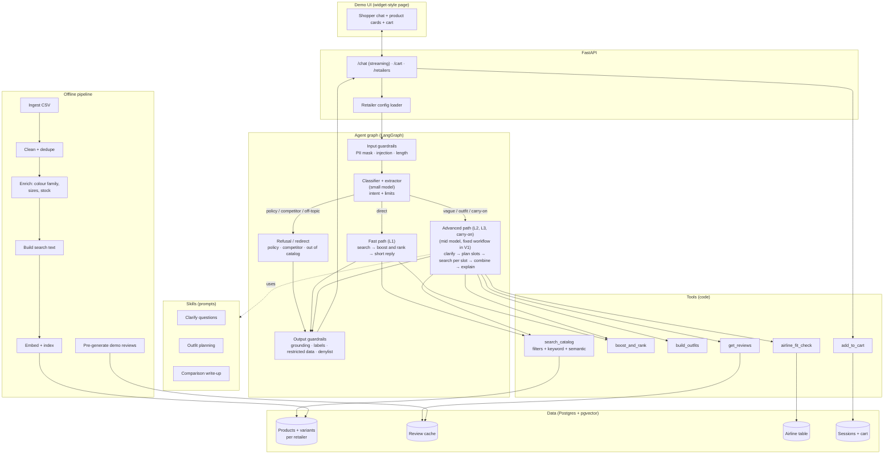

# V1 System Design Plan: Retail Shopping Agent Platform

_Team 12 · draft Nov 15, 2026 · source of requirements: PRD v2 (V1 frozen)_

> Items marked **(proposed)** are suggestions awaiting team confirmation. See [Open questions](#13-open-questions).

---

## 1. Goal of V1

A config-driven shopping agent that runs on two retailers (Nordstrom primary, Calpak secondary) and handles:
- **L1** specific item ("navy blazer under $150")
- **L2** vague item with clarifying ("a classy dress for an evening party")
- **L3** outfit ("dress me for a wedding, $400 total")
- **Carry-on fit** (Calpak + airline table)
- Refusals and redirects (policy, competitor, out of catalog, off-topic)
- Add to a mock cart

V1 is **low agency, high control**: code decides the steps; LLMs work inside steps.

---

## 2. Design principles

1. **LLM proposes, code enforces.** Prices, sizes, colour, stock, boost rules and budget totals are checked in code.
2. **Route cheap first.** A small model classifies every request; only hard requests reach the mid model.
3. **Fixed workflow in V1.** The advanced path is a fixed LangGraph workflow, not a free agent loop. V2 replaces it with an agent loop behind the same API and tools.
4. **Facts come from data, not the LLM.** Product cards (price, colour, rating, labels) are rendered from data; the LLM writes only the explanation text.
5. **One framework, many retailers.** No retailer-specific code; everything retailer-specific lives in a config file.
6. **Filter first, then rank.** Hard limits are applied inside the search query, never after a top-k.

---

## 3. Components

| Layer | Component | Technology | Responsibility |
|---|---|---|---|
| UI | Demo page | _TBD by frontend team_ | Widget-style chat, product cards, outfit cards, cart, retailer switcher |
| API | Chat, cart and retailer endpoints | **FastAPI** | Sessions, streaming replies, cart, config loading |
| Agent | Agent graph | **LangGraph** | Guardrails, classification, fast and advanced paths |
| Agent | Skills | Prompt files | Clarify, outfit planning, comparison write-up |
| Agent | Tools | Python functions | Search, boost and rank, outfits, airline check, reviews, cart |
| Data | Catalog store | **Postgres + pgvector** (proposed) | Products, variants, search text, embeddings, keyword index |
| Data | Supporting tables | Postgres | Review cache, airline table, sessions, carts |
| Offline | Data pipeline | Python scripts | Ingest, clean, enrich, build search text, embed, pre-generate reviews |
| Ops | Tracing | LangSmith or Langfuse (proposed) | Decision trace, latency, cost, eval runs |

---

## 4. Architecture diagram



---

## 5. Agent graph (LangGraph)

### 5.1 Graph state

| Field | Purpose |
|---|---|
| `retailer_id` | Selects config, catalog and category packs |
| `messages` | Conversation so far (working memory) |
| `limits` | Current structured limits: category, budget, size, colour family, occasion, style words |
| `intent` | Latest classifier output |
| `clarify_used` | Whether the one clarifying round has been used |
| `candidates` | Search results with IDs and key fields (not full records) |
| `outfits` | Proposed outfit combinations with totals |
| `trace` | Steps taken, for the decision trace and evals |

Sessions persist through a LangGraph checkpointer (in-memory for dev; Postgres for the demo, proposed).

### 5.2 Nodes

1. **Input guardrails** (code): mask personal data, length limit, injection patterns.
2. **Classifier + extractor** (small model, structured output): returns intent + limits in **one call**; sees conversation state so follow-ups ("make it blue") update limits instead of starting over.
3. **Router** (code): sends to refusal, fast path or advanced path.
4. **Fast path** (L1): `search_catalog` → `boost_and_rank` → short comparison (small or mid model, proposed: mid for quality).
5. **Advanced path** (mid model, fixed steps):
   - **Clarify gate:** if required fields are missing and `clarify_used` is false, ask 3–4 short questions in one message (clarify skill) and stop; the next turn resumes here.
   - **Plan** (outfits only): outfit-planning skill proposes slots and a budget split for the occasion.
   - **Search:** one `search_catalog` call per slot (in parallel) or one for single items.
   - **Combine** (outfits only): `build_outfits` returns 2–3 outfits within the total at different price points.
   - **Reviews:** `get_reviews` for the shortlist.
   - **Explain:** comparison write-up skill.
   - **Carry-on:** `airline_fit_check` against the airline table before explaining.
6. **Refusal / redirect** (template text, no LLM needed): policy → help page; competitor → decline; out of catalog → what it can offer.
7. **Output guardrails** (code): grounding, labels, restricted data, denylist.

### 5.3 Classifier intents

| Intent | Route | Example |
|---|---|---|
| `direct_search` | Fast path | "Navy blazer under $150" |
| `vague_item` | Advanced | "Classy dress for an evening party" |
| `outfit` | Advanced | "Dress me for a wedding, $400" |
| `carry_on_fit` | Advanced | "Carry-on that fits most airlines" |
| `compare_named` | Advanced (skip search) | "Compare these two dresses" |
| `refine` | Back to previous path with updated limits | "Actually make it blue" |
| `add_to_cart` | API cart action | "Add the second one" |
| `policy` | Refusal → help page | "What's your return policy?" |
| `competitor` | Refusal | "Is this cheaper on Amazon?" |
| `out_of_catalog` | Refusal with alternatives | "Outfit for my husband", "a tent" |
| `off_topic` / `injection` | Refusal | "Ignore your rules…" |

Out-of-catalog detection uses the retailer config (e.g. Nordstrom: women only, clothing/shoes/accessories only).

---

## 6. Skills vs. tools

**Skills** are instructions loaded into the LLM's context for one step. **Tools** are code the graph calls.

| Skills (prompts) | Tools (code) |
|---|---|
| **Clarify:** which questions to ask, from the category pack; max 3–4; skip known fields | **search_catalog:** filters + keyword + semantic search for one retailer |
| **Outfit planning:** slots and budget split per occasion (wedding: dress, heels, clutch, earrings; camping: cargo pants, fleece, hiking boots) | **boost_and_rank:** applies merchandising rules from config to exact matches only; adds "Boosted" labels |
| **Comparison write-up:** reasons, trade-offs, review highlights; never states prices | **build_outfits:** combinations within the total budget, 2–3 price points |
| _(V2) Brand voice_ | **airline_fit_check:** dimensions vs. airline table, "typical size" caveat |
| | **get_reviews:** cache lookup; generate on first view and cache |
| | **add_to_cart:** session cart |

**Brand promotion is a tool, not a skill.** If boosting lived in the prompt, the LLM could promote items that break the shopper's limits, and it couldn't be tested reliably.

---

## 7. Search design

### 7.1 Three layers

| Layer | Purpose | Example |
|---|---|---|
| **Exact filters** | Hard limits, inside the SQL query | price ≤ 150, colour_family = blue, size M in stock, category = blazers |
| **Keyword (lexical)** | Exact words, brands, product terms | "cargo", "satin midi", "North Face" |
| **Semantic (vector)** | Style and intent words | "classy", "evening", "comfy for hiking" |

### 7.2 How a query runs

1. Apply exact filters (hard limits) to get the eligible set.
2. Within that set, rank by keyword score (Postgres full-text) and by vector similarity (pgvector).
3. Merge the two rankings with **reciprocal rank fusion (RRF)**.
4. If fewer than 3 exact matches, run a second query with near-miss tolerances (price +10%, adjacent colour family) and mark those results as near misses with the reason.
5. Pass results to `boost_and_rank`.

### 7.3 Search documents

- **No chunking:** one product = one search document.
- **Nordstrom search text:** `name + brand + category path + subcategory tags + colour family + sale label`.
- **Calpak search text:** `title + product type + colour family + description + "Best for" line`.
- **Risk:** Nordstrom names rarely contain words like "classy" or "evening". **Start small:** index the search text, run the L2 scenarios; only if semantic search misses, add an offline step where a small model tags occasion and style for the demo categories.

### 7.4 Store (proposed)

**Postgres + pgvector + built-in full-text search.** Filters, keyword and vector search run in one SQL query in one database. 129k products is small for it. Alternatives: Qdrant or Chroma (extra service), SQLite + FTS5 + sqlite-vec (lightest, less standard).

### 7.5 Embeddings (proposed)

A hosted embedding model (e.g. Voyage or OpenAI small). Embedding ~130k short texts costs well under a dollar and needs no GPU. Alternative: a local open-source model (e.g. bge-small) for zero API dependency.

---

## 8. Guardrails

| Where | Check | How (start small) |
|---|---|---|
| Input | Personal data (card numbers, phone, address, email) | Regex + Presidio; mask before any LLM call |
| Input | Prompt injection | Classifier `injection` intent + simple patterns; refuse |
| Input | Off-topic, policy, competitor | Classifier intents; denied topics configurable per retailer |
| Input | Abuse, very long input | Length limit and rate limit in FastAPI |
| Output | Grounding | Every product ID in the reply must be in the tool results; prices rendered from data |
| Output | Restricted retailer data | Never reveal boost rules, margins or the system prompt; "Promoted by the retailer" is the only explanation |
| Output | Banned topics | Retailer denylist check in code |
| Output | Labels | Every boosted item labelled "Boosted"; every near miss states what it misses |
| Output | No personal data echoed | Same masking on output |
| Offline | Tone and helpfulness | LLM-as-judge in evals, not on every reply (cost) |

Untrusted data: product text and reviews are passed to the LLM as clearly marked data, never as instructions.

---

## 9. Retailer configuration

One file per retailer. Sketch (proposed format):

```yaml
retailer_id: nordstrom
display_name: Nordstrom
catalog:
  source: csv            # api | warehouse | csv
  path: data/nordstrom_clean.parquet
  field_map: { title: PRODUCT_NAME, brand: BRAND, price: PRICE_CURRENT, was_price: PRICE_RETAIL, colour_code: COLOR }
coverage:
  genders: [women]
  departments: [clothing, shoes, handbags, jewelry, accessories]
category_packs: [apparel, footwear, accessories]
merchandising:
  boosts:
    - match: { brand: "Nordstrom" }
      weight: 1.5
      label: Boosted
near_miss:
  min_exact_matches: 3
  price_tolerance_pct: 10
  allow_adjacent_colour: true
guardrails:
  denied_topics: [competitors, store_policies]
  help_page_url: https://www.nordstrom.com/browse/customer-service
brand_voice: null        # V2
```

The **locked platform rules** (boosted = exact matches only, labels always shown, no made-up facts) live in code and can't be overridden by config.

---

## 10. Offline data pipeline

| Step | Nordstrom | Calpak |
|---|---|---|
| Ingest | CSV | CSV |
| Clean | Dedupe by SKU; drop New Arrivals duplicates and Fine Jewelry | Drop zero-price items; strip internal tags |
| Enrich | Colour code → colour family lookup table; synthetic sizes and stock (fixed seed) | Colour name → colour family (LLM, human-checked); size class from product type; dimensions per size class |
| Supporting data | — | Airline lookup table |
| Search text | Built per product (7.3) | Built per product (7.3) |
| Embed + index | Vectors + full-text index | Vectors + full-text index |
| Reviews | Pre-generate for demo-scenario products (consistent with real rating) | Pre-generate for demo-scenario products |

Reviews for other products are generated on first view and cached (`get_reviews`).

---

## 11. API (FastAPI)

| Endpoint | Purpose |
|---|---|
| `POST /chat` | Send a message; streams the reply (server-sent events, proposed) plus structured product/outfit cards |
| `GET /retailers` | List configured retailers for the switcher |
| `GET /cart` / `POST /cart` / `DELETE /cart/{item}` | Mock cart |
| `GET /health` | Health check |

Each request carries `session_id` and `retailer_id`. The reply returns two parts: **text** (LLM explanation) and **cards** (structured data the UI renders).

---

## 12. Models, cost and latency

| Role | Tier | Proposed |
|---|---|---|
| Classifier + extractor | Small | Claude Haiku 5.5 (or equivalent) |
| Advanced path (clarify, plan, explain) | Mid | Claude Sonnet 5.5 (or equivalent) |
| Offline enrichment and review generation | Small | Claude Haiku 5.5 (batch) |
| Eval judge | Mid or frontier | Offline only |

No fine-tuning in V1.

**Calls per request (estimate, to be measured):**

| Path | LLM calls | Main latency driver |
|---|---|---|
| Refusal | 1 (classifier) | Classifier |
| Fast path (L1) | 2 | Explanation output |
| Advanced, single item (L2) | 2–3 + 1 if clarifying | Explanation output |
| Outfit (L3) | 3–4 + 1 if clarifying | Plan + explanation; parallel slot searches keep search time flat |

**Optimizations to start with:** prompt caching for system prompts and skills; parallel slot searches; compact tool outputs (IDs + key fields); stream the explanation; pre-generated reviews for demo products.

---

## 13. Open questions

| # | Question | Proposed default |
|---|---|---|
| 1 | V1 advanced path as a fixed LangGraph workflow, agent loop in V2? | Yes |
| 2 | Classifier returns intent + limits in one call, aware of conversation state? | Yes |
| 3 | Boosting in ranking code, not a skill? | Yes |
| 4 | Data store, and where it runs (local Docker vs. cloud) | Postgres + pgvector, local Docker for dev |
| 5 | Embedding model: hosted or local | Hosted |
| 6 | Model provider for both tiers | Claude Haiku (small) + Sonnet (mid) |
| 7 | "Sensitive or restricted data": shopper personal data, retailer internals, or both | Both |
| 8 | Guardrail tooling: light custom + Presidio, or a framework (e.g. NeMo Guardrails) | Light custom |
| 9 | Tracing and evals: LangSmith or Langfuse | LangSmith |
| 10 | Frontend technology and streaming (server-sent events) | Frontend team to decide; streaming yes |
| 11 | Fast path model: small or mid | Mid for reply quality; measure |
| 12 | Image dataset (from PRD) | Decide Monday Nov 16 |

---

## 14. Next steps

1. Team answers the open questions (Mon Nov 16).
2. Data owners: run the offline pipeline for both retailers; build the colour lookup and airline table.
3. Agent owners: graph skeleton with classifier and router; then fast path; then advanced path.
4. API/UI owners: `/chat` streaming with mock responses so UI work starts in parallel.
5. Eval owner: turn PRD scenarios and edge cases into a test set with expected intents and results.
